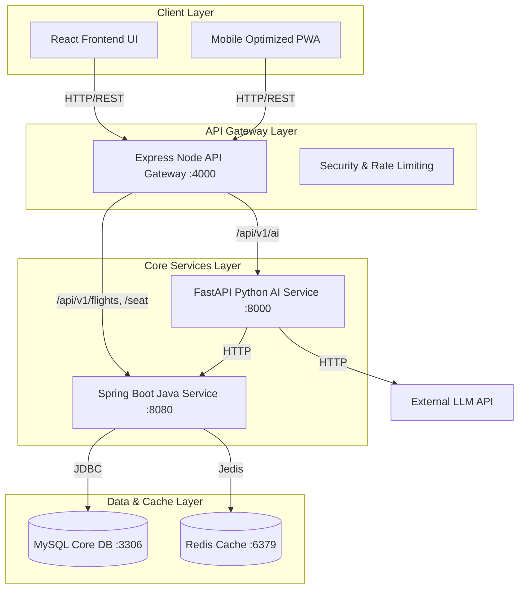

# ✈️ Airline Nexus 2.0 - Core Architecture Manifesto

## 1. System Overview
Airline Nexus is a production-grade, highly reliable, and intelligent airline platform. It handles real-time flight bookings, dynamic seat maps, intelligent caching, context-aware digital environments, and AI-powered travel assistance.

The architecture strictly adheres to a **Zero Fake Functionality** policy, meaning every seat selection, fare calculation, and flight schedule is backed by a verifiable source of truth in the transactional database.

## 2. Global Architecture Diagram

## 3. Technology Stack
* **Frontend:** React.js, TailwindCSS, Framer Motion, Axios
* **Backend (Core Transactional):** Java, Spring Boot, Spring Data JPA, Hibernate
* **Backend (Intelligence Layer):** Python, FastAPI, Pydantic, HTTPX
* **API Gateway:** Node.js, Express, HTTP-Proxy-Middleware
* **Database:** MySQL 8.0 (Transactional Source of Truth)
* **Caching & distributed Locking:** Redis
* **Infrastructure:** Docker, Docker Compose, Kubernetes Ready

## 4. Key Architectural Decisions

### 4.1 Real-Time Seat Map Concurrency (Rule 14 & Rule 3)
* **Problem:** Preventing double-bookings and race conditions during seat selection.
* **Solution:** 
  * The frontend renders a 3D matrix (S1-S64) based on backend availability.
  * When a user selects a seat, a distributed lock is placed via the `/seat/hold/specific` endpoint.
  * The lock has a 5-minute TTL.
  * Permanent confirmation is flushed to the `Booking` entity's `seat_numbers` column upon checkout.

### 4.2 AI Hallucination Firewall (Rule 11)
* **Problem:** Ensuring AI doesn't hallucinate non-existent flights or policies.
* **Solution:** 
  * The Python AI service uses a RAG (Retrieval-Augmented Generation) pattern.
  * It first fetches the live database state from the Java Core (`/flights/all`).
  * The AI is strictly prompted to synthesize pros, explanations, and baggage policies *only* from the verified payload.

### 4.3 Context-Aware Engine (Rule 7 & 80)
* **Problem:** The UI needs to feel alive without lagging the user's connection.
* **Solution:** 
  * `PixabayService` caches external image queries in a ConcurrentHashMap (or Redis).
  * `useAviationBackground.js` manages a dual-layer crossfade engine (`Layer A` and `Layer B`).
  * Images are preloaded asynchronously before the CSS transition fires.

### 5. Resiliency (Circuit Breakers & Observability)
* `GlobalExceptionHandler` intercepts unchecked exceptions in the Java core.
* Structured logging enforces clean stack traces for debugging.
* Redis failures gracefully fallback to an In-Memory `ConcurrentHashMap` to preserve uptime during cache evictions or network splits.
